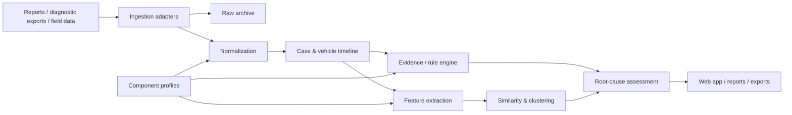

# NTF Insight

**Component-agnostic field-failure and root-cause analytics for No Trouble Found (NTF) cases.**

NTF Insight is a Python project for reconstructing and analysing vehicle field cases around replaced components. The first use case is a coolant pump whose own diagnostic capability is limited, while the surrounding vehicle — especially the controlling ECU and workshop/field history — contains the evidence needed to understand the case.

The architecture is intentionally **not tied to one component**. Coolant pumps, HV batteries and future component families should use the same generic case, timeline, evidence, similarity and reporting engines, with component-specific profiles and rules layered on top.

> **Status:** project scaffold / pre-alpha. No production data connectors or decision logic are implemented yet.

## Questions the project should answer

For every vehicle / case, NTF Insight should eventually help answer questions such as:

- Why was the returned component classified as NTF?
- Was the replaced component a plausible root cause?
- Did the same fault reappear after component replacement?
- How long / how many kilometres passed until recurrence?
- Did new faults appear after replacement?
- Which evidence points toward the component, vehicle, wiring, software, workshop process or another system?
- Is supplier involvement supported by evidence, unsupported or still unknown?
- Which NTF cases are diagnostically similar?
- Are certain part numbers, variants, suppliers, batches, software states or vehicle populations overrepresented?
- Which cases should an expert review first?
- Which data is missing and prevents a reliable conclusion?

## Design principles

1. **Vehicle- and case-centred, not component-centred**  
   The exchanged part is one event in a larger vehicle history.

2. **Event-based timeline**  
   DTCs, workshop visits, replacements, software changes, supplier findings and reports are represented as dated events.

3. **Explainability before automation**  
   Root-cause assessments must expose the evidence that supports or weakens a conclusion.

4. **Component-agnostic core**  
   Generic logic lives in the core analysis layers. Component-specific knowledge lives in component profiles.

5. **Rules and ML are separate concerns**  
   Rules encode engineering knowledge. Similarity / clustering discovers recurring patterns. A cluster is not automatically a root cause.

6. **Traceability to source data**  
   Derived findings should remain traceable to the original report, diagnostic export or manual source.

7. **Raw data is immutable**  
   Source files are archived unchanged; parsing and enrichment create derived data.

8. **Sensitive field data never belongs in Git**  
   Real VINs/FINs, raw reports, credentials and confidential supplier data must stay outside the repository.

## High-level architecture



## Component extensibility

A component profile should describe only the knowledge that differs between component families, for example:

- relevant ECUs and DTC families
- component-specific event parsers
- known failure modes
- recurrence rules
- supplier / part metadata
- component-specific features
- evidence rules and thresholds

Conceptually:

```text
components/
├── coolant_pump/
│   ├── rules
│   ├── feature definitions
│   └── mappings
├── hv_battery/
│   ├── rules
│   ├── feature definitions
│   └── mappings
└── ...
```

The generic timeline, evidence, similarity, storage and UI layers should not need to know whether a case concerns a pump or a battery.

## Initial domain model

The first domain model is expected to revolve around:

- `Vehicle`
- `NTFCase`
- `DiagnosticEvent`
- `RepairEvent`
- `PartReplacement`
- `SoftwareEvent`
- `SupplierFinding`
- `Evidence`
- `Assessment`

A replacement event is the central anchor for **pre/post analysis**.

Example windows:

```text
PRE          replacement          POST_SHORT           POST_LONG
<----------------|--------------------|-------------------->
```

The exact time and mileage windows should be configurable per component and validated on real cases.

## Repository structure

```text
ntf-insight/
├── docs/                       # Architecture and engineering documentation
├── data/                       # Documentation only; no real field data in Git
├── src/ntf_insight/
│   ├── app/                    # Future UI / application layer
│   ├── domain/                 # Generic entities and value objects
│   ├── ingestion/              # Source adapters and parsers
│   ├── storage/                # Persistence abstractions
│   ├── analysis/               # Timeline, recurrence, rules, features, clustering
│   └── components/
│       ├── coolant_pump/       # First component profile
│       └── hv_battery/         # Future / reference component profile
├── tests/
├── ROADMAP.md
├── pyproject.toml
└── README.md
```

## Planned analysis layers

### 1. Timeline reconstruction

Bring all evidence for one vehicle into a chronological view:

```text
DTCs -> workshop visit -> replacement -> DTCs after replacement -> supplier finding
```

### 2. Replacement recurrence analysis

Derived features should include at least:

- `same_fault_before_after`
- `new_fault_after_replacement`
- `fault_disappeared_after_replacement`
- `time_to_recurrence`
- `distance_to_recurrence`
- `related_ecus_before_after`

### 3. Evidence-based root-cause assessment

The system should distinguish between categories such as:

- component / supplier
- vehicle electrical supply
- wiring / connector
- controlling ECU / software
- surrounding vehicle system
- workshop / process
- unknown / insufficient evidence

Assessments should contain both a result and the evidence behind it.

### 4. Similarity and clustering

Clustering is intended to discover recurring diagnostic patterns, not to assign blame.

Supplier, batch and part metadata should generally be evaluated **after** diagnostic clustering so that the clustering itself is not trivially driven by supplier identity.

## Getting started

### Requirements

- Python 3.11+
- Git

### Local setup

```bash
git clone https://github.com/gregoriuscahyanto/ntf-insight.git
cd ntf-insight

python -m venv .venv
```

Activate the environment and install the project in development mode:

```bash
python -m pip install -e ".[dev]"
pytest
```

The current test suite contains only a scaffold smoke test.

## Development conventions

- Keep the generic domain model independent from a specific component.
- Put source-system specifics behind ingestion adapters.
- Put component-specific engineering knowledge under `components/`.
- Prefer small, testable transformations over large notebooks or scripts.
- Store derived datasets in reproducible formats such as Parquet / DuckDB later, but keep raw source files unchanged.
- Every automated assessment should be reproducible from stored input evidence.
- Use synthetic or anonymised fixtures in tests.

## Data protection and confidentiality

This project is intended to work with potentially sensitive field, vehicle, diagnostic and supplier information.

Do **not** commit:

- real VINs / FINs
- downloaded field or workshop reports
- customer information
- credentials, tokens or cookies
- confidential supplier findings
- proprietary diagnostic databases or exports

Use synthetic or irreversibly anonymised data for examples and automated tests.

## Roadmap

See [ROADMAP.md](ROADMAP.md) for the implementation plan.

The first implementation milestone is deliberately small: create a reliable case model, import a small set of synthetic cases and reproduce a vehicle timeline around a component replacement before adding clustering or a polished UI.
