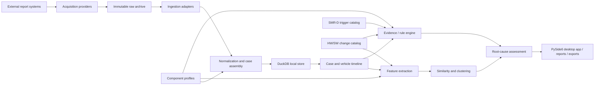

# NTF Insight

**Component-agnostic field-failure and root-cause analytics for No Trouble Found (NTF) cases.**

NTF Insight is a Python project for reconstructing and analysing vehicle field cases around replaced components. The first use case is a coolant pump whose own diagnostic capability is limited, while the surrounding vehicle — especially the controlling ECU and workshop/field history — contains the evidence needed to understand the case.

The architecture is intentionally **not tied to one component**. Coolant pumps, HV batteries and future component families should use the same generic case, timeline, evidence, similarity and reporting engines, with component-specific profiles and rules layered on top.

> **Status:** pre-alpha native desktop prototype. Local parsers now cover QEC case spreadsheets, AutoExport diagnosis/workshop CSVs and QuickTest PDFs with bounded FIN/case linking and immutable raw archives. Supplier PDFs, Candela/CDD semantics, SMR-D triggers and HW/SW release-change sources still require format-specific validation.

## Questions the project should answer

For every vehicle / case, NTF Insight should eventually help answer questions such as:

- Why was the returned component classified as NTF?
- Was the replaced component a plausible root cause?
- Did the same fault reappear after component replacement?
- How long / how many kilometres passed until recurrence?
- Did new faults appear after replacement?
- Which evidence points toward the component, vehicle, wiring, software, workshop process or another system?
- Is supplier involvement supported by evidence, unsupported or still unknown?
- Which NTF cases are diagnostically similar?
- Are certain part numbers, variants, suppliers, batches, software states or vehicle populations overrepresented?
- Which cases should an expert review first?
- Which data is missing and prevents a reliable conclusion?

## Design principles

1. **Vehicle- and case-centred, not component-centred**  
   The exchanged part is one event in a larger vehicle history.

2. **Event-based timeline**  
   DTCs, workshop visits, replacements, software changes, supplier findings and reports are represented as dated events.

3. **Explainability before automation**  
   Root-cause assessments must expose the evidence that supports or weakens a conclusion.

4. **Component-agnostic core**  
   Generic logic lives in the core analysis layers. Component-specific knowledge lives in component profiles.

5. **Rules and ML are separate concerns**  
   Rules encode engineering knowledge. Similarity / clustering discovers recurring patterns. A cluster is not automatically a root cause.

6. **Traceability to source data**  
   Derived findings should remain traceable to the original report, diagnostic export or manual source.

7. **Raw data is immutable**  
   Source files are archived unchanged; parsing and enrichment create derived data.

8. **Sensitive field data never belongs in Git**  
   Real VINs/FINs, raw reports, credentials and confidential supplier data must stay outside the repository.

## High-level architecture



## Component extensibility

A component profile should describe only the knowledge that differs between component families, for example:

- relevant ECUs and DTC families
- component-specific event parsers
- known failure modes
- recurrence rules
- supplier / part metadata
- component-specific features
- evidence rules and thresholds

Conceptually:

```text
components/
├── coolant_pump/
│   ├── rules
│   ├── feature definitions
│   └── mappings
├── hv_battery/
│   ├── rules
│   ├── feature definitions
│   └── mappings
└── ...
```

The generic timeline, evidence, similarity, storage and UI layers should not need to know whether a case concerns a pump or a battery.

## Initial domain model

The first domain model is expected to revolve around:

- `Vehicle`
- `NTFCase`
- `DiagnosticSession`
- `DiagnosticEvent`
- `DTCTriggerDefinition`
- `ECUChangeRecord`
- `RepairEvent`
- `PartReplacement`
- `SoftwareEvent`
- `SupplierFinding`
- `Evidence`
- `Assessment`

A replacement event is the central anchor for **pre/post analysis**.

Example windows:

```text
PRE          replacement          POST_SHORT           POST_LONG
<----------------|--------------------|-------------------->
```

The exact time and mileage windows should be configurable per component and validated on real cases.

## Repository structure

```text
ntf-insight/
├── docs/                       # Architecture and engineering documentation
├── data/                       # Documentation only; no real field data in Git
├── src/ntf_insight/
│   ├── acquisition/            # Provider contracts for automated report download
│   ├── app/                    # PySide6 desktop UI / application layer
│   ├── domain/                 # Generic entities and value objects
│   ├── ingestion/              # Source adapters and parsers
│   ├── storage/                # Persistence abstractions
│   ├── analysis/               # Timeline, recurrence, evidence, quality, similarity
│   ├── demo/                   # Synthetic development/reference fixtures
│   └── components/
│       ├── coolant_pump/       # First component profile
│       └── hv_battery/         # Future / reference component profile
├── tests/
├── ROADMAP.md
├── pyproject.toml
└── README.md
```

## Planned analysis layers

### 1. Timeline reconstruction

Bring all evidence for one FIN/case combination into a chronological table and time plot:

```text
DTCs -> workshop visit -> replacement -> DTCs after replacement -> supplier finding
```

### 2. Replacement recurrence analysis

Derived features should include at least:

- `same_fault_before_after`
- `new_fault_after_replacement`
- `fault_disappeared_after_replacement`
- `time_to_recurrence`
- `distance_to_recurrence`
- `related_ecus_before_after`

### 3. Evidence-based root-cause assessment

The system should distinguish between categories such as:

- component / supplier
- vehicle electrical supply
- wiring / connector
- controlling ECU / software
- surrounding vehicle system
- workshop / process
- unknown / insufficient evidence

Assessments should contain both a result and the evidence behind it.

### 4. Similarity and clustering

Clustering is intended to discover recurring diagnostic patterns, not to assign blame.

Supplier, batch and part metadata should generally be evaluated **after** diagnostic clustering so that the clustering itself is not trivially driven by supplier identity.

## Getting started

### Requirements

- Python 3.11+
- Git

### Local setup

```bash
git clone https://github.com/gregoriuscahyanto/ntf-insight.git
cd ntf-insight

python -m venv .venv
```

Activate the environment and install the project in development mode:

```bash
python -m pip install -e ".[dev]"
pytest
```

Start the desktop application:

```bash
python -m ntf_insight
# or, after installation:
ntf-insight
```

The GUI is a native **PySide6 / Qt desktop application**. The analysis core remains independent of the GUI so that other frontends can be added later without rewriting the engineering logic.

The test suite covers domain models, synthetic cases, GUI startup, raw-file archiving, DuckDB round-trips, case assembly, recurrence, reference knowledge, evidence generation, data quality, similarity, supplier denominators and acquisition orchestration.

## Local data directory

The desktop app stores local working data outside the Git repository by default:

```text
~/.ntf-insight/
├── ntf-insight.duckdb
└── raw/
```

Set `NTF_INSIGHT_DATA_DIR` to override that location. If the database contains no imported cases, the app starts in clearly labelled **demo mode** with fictional data. The Data Sources page archives arbitrary original files with SHA-256 provenance. Known QEC, AutoExport and QuickTest formats are now also parsed locally; unsupported sources remain archived with an explicit pending state.

## Desktop views

The current prototype includes Overview, Data Sources, a combined FIN/Case workspace, DTC Explorer, **Case clusters & DTC-Cluster visualization**, Suppliers and Data Quality. The FIN/Case workspace treats the FIN + case combination as the analysis unit and includes a chronological time plot for DTCs, diagnostic sessions, ECU states, replacements, software, workshop and supplier events. Data Sources supports multiple files and ZIP packages with local Drag & Drop, automatic format detection and asynchronous ingestion into DuckDB. The Case view can export a deterministic Markdown analysis report.

## Echte Quelldateien lokal laden

Auf einem für Felddaten zugelassenen Rechner im Tab **Datenquellen** die
**Quellenart „Automatisch erkennen“** wählen und ein ZIP oder mehrere
Einzeldateien hineinziehen. QEC-Excel legt FIN/Fall-Anker an, AutoExport-CSV
ergänzt Diagnose-/Werkstattinformationen, QuickTest-PDF ergänzt vollständige
Diagnosesitzungen einschließlich ECU-HW/SW-Ständen.

Alternativ für große ZIP-Pakete:

```powershell
ntf-insight-import "C:\\interner-pfad\\quellen.zip"
python -m ntf_insight
```

Echte Fahrzeug-/Werkstattdaten werden **nicht nach GitHub hochgeladen**,
sondern ausschließlich im konfigurierten lokalen Datenverzeichnis archiviert,
verarbeitet und verknüpft. Unklare FIN/Fall-Zuordnungen werden nicht erzwungen.

Details und aktuelle Grenzen: [docs/real-data-import.md](docs/real-data-import.md).

## QuickTest-PDF mit automatischer FIN-Zuordnung

In **Datenquellen** einen oder mehrere QuickTest-PDFs per Drag & Drop
einfügen. NTF Insight erkennt das Format und liest automatisch FIN,
Diagnosezeit, Kilometerstand, alle Steuergeräte-HW/SW-Metadaten,
DTC-Code/-Status/-Häufigkeit sowie Snapshot-Parameter und den vollständigen
auslesbaren PDF-Seitentext aus.

Das Ergebnis wird **direkt FIN-bezogen in der lokalen DuckDB** gespeichert –
**auch ohne vorhandenen QEC-Fall**. Die App zeigt die Daten unter
**Fälle / FIN → QuickTests nach FIN**. Ein später importierter passender
QEC-Fall kann die bereits gespeicherten Diagnoseereignisse als
abgeleitete Falltimeline übernehmen.

Der ältere einmalige SQLite-Export ist für diese App-Funktion **nicht**
erforderlich. Die PDF-Originale und die Fahrzeugdaten werden nicht nach
GitHub übertragen.

[QuickTest-Import: Bedienung, Datenbanktabellen und Grenzen](docs/quicktest-fin-import.md)

## Manuelle Fallerfassung

Unter **Fälle / FIN** sind **+ Neuer Fall** und **+ Ereignis** verfügbar. Kurztests (auch mit **0 DTCs**), DTCs, Tausche, Werkstattmaßnahmen, ECU-HW/SW-Stände, Software-Updates, Lieferantenbefunde und freie Notizen können ohne Parser erfasst werden.

Ein Eintrag lässt sich über **Ereignistabelle → Markiertes Ereignis korrigieren** überarbeiten. **Änderungsverlauf** zeigt den Vorher-/Nachher-Zustand mit Zeitstempel und lokalem Benutzer. Manuelle Informationen werden in DuckDB gespeichert; Originaldateien bleiben unverändert.

Demo-Fälle sind schreibgeschützt. Ein neu angelegter echter Fall wechselt automatisch in den lokalen Datenmodus, ohne die Demo-Daten zu übernehmen. Bei jeder Speicherung aktualisiert die App die anderen Ansichten.

Anleitung und Grenzen: [docs/manual-entry.md](docs/manual-entry.md).

## Fallähnlichkeit und Clustering

Unter **Cluster & Fälle → Fall-Cluster** vergleicht NTF Insight jetzt FIN/Fall-Kombinationen anhand ihrer **Diagnosesignatur vor dem Austausch**. Die native Desktop-App zeigt Complete-Link-Fallcluster, eine Ähnlichkeitsmatrix (Heatmap) mit Begründungen und je ausgewähltem Fall eine Rangliste vergleichbarer historischer Fälle einschließlich der dokumentierten Maßnahmen und Nachtestergebnisse.

**PCA wird hierfür nicht als Clusteringverfahren verwendet.** Die aktuelle Grundlage sind nachvollziehbare, gewichtete Jaccard-Ähnlichkeiten für DTCs, ECUs und weitere verfügbare Vorher-Merkmale. Post-Tausch-Rekurrenz, Lieferant und Reparaturmaßnahme fließen nicht in den diagnostischen Score ein. Ein gleiches Fehlerbild garantiert keine gleiche Abhilfe.

Methodik, aktuelle Gewichte, Grenzen und geplanter Ausbau zu HDBSCAN/UMAP: [docs/case-clustering.md](docs/case-clustering.md).

## Development conventions

- Keep the generic domain model independent from a specific component.
- Put source-system specifics behind ingestion adapters.
- Put component-specific engineering knowledge under `components/`.
- Prefer small, testable transformations over large notebooks or scripts.
- Store normalized data locally in DuckDB / Parquet-compatible structures and keep raw source files unchanged.
- Every automated assessment should be reproducible from stored input evidence.
- Use synthetic or anonymised fixtures in tests.

## Data protection and confidentiality

This project is intended to work with potentially sensitive field, vehicle, diagnostic and supplier information.

Do **not** commit:

- real VINs / FINs
- downloaded field or workshop reports
- customer information
- credentials, tokens or cookies
- confidential supplier findings
- proprietary diagnostic databases or exports

Use synthetic or irreversibly anonymised data for examples and automated tests.

## Input data

See [docs/data-requirements.md](docs/data-requirements.md) for the minimum and recommended source files and [docs/source-contracts.md](docs/source-contracts.md) for canonical parser outputs. In addition to per-vehicle events, NTF Insight treats SMR-D DTC trigger definitions and HW/SW release changes as versioned engineering reference knowledge. A known diagnostic session with zero relevant DTCs is preserved explicitly so missing data is never confused with a clean post-replacement test.

## Roadmap

See [ROADMAP.md](ROADMAP.md) for the implementation plan.

Concrete QEC, AutoExport CSV and QuickTest PDF formats are now supported by synthetic regression-tested local ingestion. Next priorities are expert review of imported cases, Candela/SMR-D semantics, HW/SW change-history formats and supplier-report extraction.

## Weitere Dokumentation

- [Mercedes-Benz Corporate Design](docs/mercedes-design.md)
- [Managed Windows Environment](docs/windows-managed-environment.md)
- [Enterprise CI/CD Pipeline](docs/enterprise-pipeline.md)
- [Canonical Source Contracts](docs/source-contracts.md)
- [Lokaler ZIP- und Echtdatenimport](docs/real-data-import.md)
- [Automatischer QuickTest-PDF-Import nach FIN](docs/quicktest-fin-import.md)
- [Manuelle Fallerfassung](docs/manual-entry.md)
- [Fall-Clustering und Ähnlichkeitsmethodik](docs/case-clustering.md)
